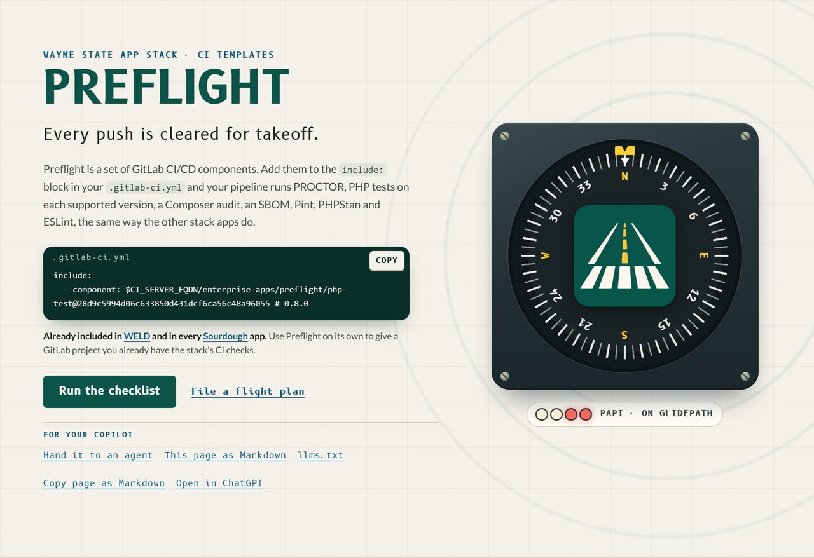
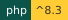
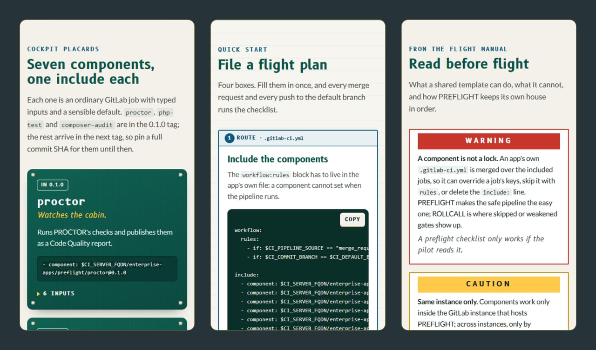
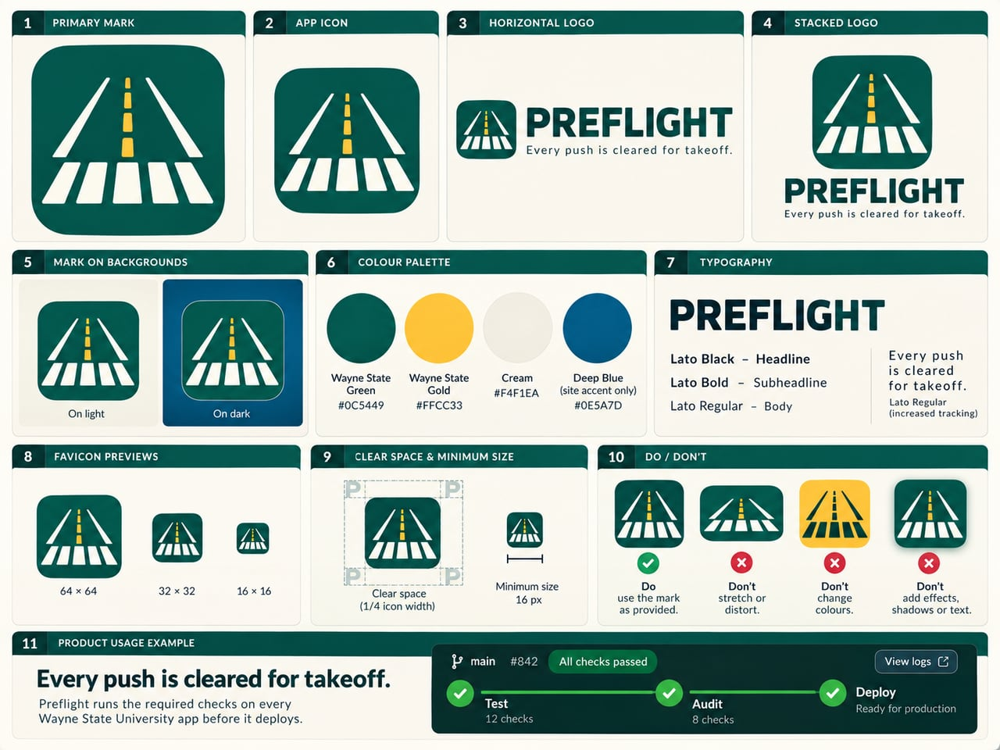

<div align="center">
  <a href="site/index.html"></a>
</div>

# Preflight

<div align="center">
  
  
  
</div>

**Every push is cleared for takeoff.**

Preflight is a set of GitLab CI/CD components that give every WSU app the
same checks: PROCTOR, PHP tests on each supported version, Composer audit,
an SBOM, Pint, PHPStan, ESLint, secret detection and an accessibility gate.

**Not to be confused with:** Preflight is the CI pipeline; it runs Pinstripe's style checks and PROCTOR but sets neither.

Front page: [`site/index.html`](site/index.html), a static page; see [`site/README.md`](site/README.md).
On Citadel it is served by the raw-PHP deploy layer in [`deploy/`](deploy/): a Squire kit whose front controller serves `site/` behind HELMET's security headers. For local development, keep serving `site/` directly.
Documentation: the full manual lives at [preflight.apps.wayne.edu/docs/](https://preflight.apps.wayne.edu/docs/).

## Where the code lives

The canonical repository is [enterprise-apps/preflight](https://git.wayne.edu/enterprise-apps/preflight) on
git.wayne.edu. Clone it over SSH (`git@git.wayne.edu:enterprise-apps/preflight.git`) or HTTPS
(`https://git.wayne.edu/enterprise-apps/preflight.git`), and open issues and merge requests there. Tags are made
there, by the maintainer, with an approver.
GitHub ([waynestate/preflight](https://github.com/waynestate/preflight)) is a read-only push mirror of
git.wayne.edu. Nobody pushes to it; Packagist and npm read from it.
CI runs on git.wayne.edu, on its instance runner. Cleared for takeoff from git.wayne.edu; the mirror is just
another gate.

<details>
<summary><b>Walk round the aircraft</b>: the placards, the flight plan and the flight manual from the front page</summary>
<br>
<div align="center"></div>
</details>

Components are GA on the Free tier since GitLab 17.0. They work only within
the same GitLab instance that hosts this project.

## Components

<div align="center">
  
</div>

<div align="center"><sub>The checklist, item by item, with each item's job and timeout read from <code>templates/</code>.</sub></div>

### The inputs contract

The inputs and job names below are a promise, written down in
[`contract/inputs.json`](contract/inputs.json): every input's name, type, default
and pattern, and every job each component adds. Preflight's own build fails when a
template drifts from it (`tests/ComponentsContractTest.php` in `composer ci`, and the
`contract` job), so the surface changes only on purpose, with the file rewritten by
`composer contract:update` in the same commit. An input or job is renamed or removed
only in a release whose [Upgrading](docs/upgrading.md) section lists it under Breaking,
and before 1.0 that is a new minor, never a patch. Before you move a pin, see what moved:

```
git diff 0.3.1 0.4.0 -- contract/inputs.json
```

[The inputs contract](docs/guides/inputs-contract.md) explains what counts as breaking
and why defaults such as image digests still move between releases.

### proctor

Runs `vendor/bin/proctor check --format=codequality` and publishes the
result as a GitLab Code Quality report. The job installs the app's
dependencies with `composer install --no-plugins --no-scripts --ignore-platform-reqs`, so the
app's plugins and scripts never run inside the job, and an app locked to an
older PHP or needing an extension the image lacks still gets its report.

```yaml
include:
  - component: $CI_SERVER_FQDN/enterprise-apps/preflight/proctor@87d9b6fc6b0ed302dd729986525282cd7b567ebd # 0.4.0
    inputs:
      proctor_command: vendor/bin/proctor check --format=codequality
```

| Input | Type | Default | What it does |
|-------|------|---------|--------------|
| `stage` | string | `test` | Pipeline stage for the job. |
| `job_name` | string | `proctor` | Name of the job. Set it when you include this component more than once. |
| `image` | string | `php:8.4-cli-trixie@sha256:9cf851bc2c1b37c3e59dfd677a3c3e56d485af5a47c93f629424bb039eafcb69` | Docker image for the job. |
| `image_prefix` | string | `${CI_DEPENDENCY_PROXY_GROUP_IMAGE_PREFIX}` | Registry path in front of `image`: the job pulls `image_prefix/image`. The default is the group's GitLab Dependency Proxy, so Docker Hub is asked once and GitLab serves the cached copy. Outside a group with the proxy, set `docker.io`. No trailing slash. |
| `composer_version` | string | `2.11.1` | Composer version to install. |
| `allow_failure` | boolean | `false` | Whether the job can fail without failing the pipeline. |
| `proctor_command` | string | `vendor/bin/proctor check --format=codequality` | The proctor command to run. |
| `working_dir` | string | `.` | Directory to run the command in, relative to the project root. |
| `git_depth` | string | `"0"` | How many commits the job clones (GitLab's `GIT_DEPTH`); the default `0` clones the full history, so PROCTOR's override-approver check can see who wrote each override. |

The job also keeps PROCTOR's JSON report (what `--format=json` prints) as
`proctor.json` in its artifact, for 30 days, whether it passed or failed.
That file is what Rollcall reads with `ROLLCALL_PROCTOR_SOURCE=gitlab`: the
fleet census takes each app's newest `proctor.json` instead of a folder of
reports someone copied by hand. It needs PROCTOR 0.11.0 or later (`proctor
check --record`). The job asks the app's own PROCTOR (`check --help`) and adds
`--record "$CI_PROJECT_DIR/proctor.json"` only when it lists the option, so
PROCTOR 0.10.0 and older run exactly as before and the runner just warns that
`proctor.json` matched no files. The flag is added only to a plain
`proctor check` command (letters, digits, spaces and `/ . _ = : , @ % + -`, no
`--record` of its own); a `gate` command, or one with quotes, `$`, `;`, `&&`
or a pipe, is left as written. The proctor line's exit code still decides the
job.

### php-test

Runs the test command on each supported PHP version through `parallel:matrix`.

```yaml
include:
  - component: $CI_SERVER_FQDN/enterprise-apps/preflight/php-test@87d9b6fc6b0ed302dd729986525282cd7b567ebd # 0.4.0
    inputs:
      test_command: vendor/bin/phpunit
```

| Input | Type | Default | What it does |
|-------|------|---------|--------------|
| `stage` | string | `test` | Pipeline stage for the jobs. |
| `job_name` | string | `php-test` | Name of the job. Set it when you include this component more than once. |
| `image` | string | `php:${PHP_VERSION}-cli-trixie` | Docker image for the jobs. The default carries the literal `${PHP_VERSION}`, which GitLab expands in the image at job time. |
| `image_prefix` | string | `${CI_DEPENDENCY_PROXY_GROUP_IMAGE_PREFIX}` | Registry path in front of `image`: the job pulls `image_prefix/image`. The default is the group's GitLab Dependency Proxy, so Docker Hub is asked once and GitLab serves the cached copy. Outside a group with the proxy, set `docker.io`. No trailing slash. |
| `php_versions` | array | `["8.3", "8.4", "8.5"]` | PHP versions to test against. |
| `composer_version` | string | `2.11.1` | Composer version to install. |
| `test_command` | string | `vendor/bin/phpunit` | The test command to run. |
| `working_dir` | string | `.` | Directory to run the command in, relative to the project root. |

#### Caching

The jobs always cache Composer downloads in `.composer-cache/` so repeat runs
do not re-download every package. The cache key is fixed per PHP version, not
a `composer.lock` hash (D-072), so a lock change downloads only the packages
that changed and each PHP version gets its own cache.

#### Try the next PHP release without breaking the pipeline

Include `php-test` a second time for the release that is not supported yet, name that job, and let it fail. The name
is what lets your own `.gitlab-ci.yml` loosen only that job:

```yaml
include:
  - component: $CI_SERVER_FQDN/enterprise-apps/preflight/php-test@<full commit SHA> # <tag>
    inputs:
      php_versions: ["8.6"]
      job_name: php-test-next
      # While 8.6 only has release candidate images, name the tag: php:${PHP_VERSION}-rc-cli-trixie
      # image: "php:${PHP_VERSION}-rc-cli-trixie"

php-test-next:
  allow_failure: true
```

A red `php-test-next` job is an early warning, not a stop. Drop the `allow_failure` and move the version into the main
`php_versions` list once the release is supported (the supported versions follow `policy.json`).

### composer-audit

Runs `composer audit --locked` and fails on advisories.

```yaml
include:
  - component: $CI_SERVER_FQDN/enterprise-apps/preflight/composer-audit@87d9b6fc6b0ed302dd729986525282cd7b567ebd # 0.4.0
    inputs:
      working_dir: .
```

| Input | Type | Default | What it does |
|-------|------|---------|--------------|
| `stage` | string | `test` | Pipeline stage for the job. |
| `job_name` | string | `composer-audit` | Name of the job. Set it when you include this component more than once. |
| `image` | string | `composer:2.11.1@sha256:8de2184c6de224f4689e8f80ed5f5edaf0030b6b8b7839a22a2bcb6722ac87d0` | Docker image for the job. |
| `image_prefix` | string | `${CI_DEPENDENCY_PROXY_GROUP_IMAGE_PREFIX}` | Registry path in front of `image`: the job pulls `image_prefix/image`. The default is the group's GitLab Dependency Proxy, so Docker Hub is asked once and GitLab serves the cached copy. Outside a group with the proxy, set `docker.io`. No trailing slash. |
| `working_dir` | string | `.` | Directory to run composer audit in, relative to the project root. |
| `abandoned` | string | `fail` | How composer audit treats abandoned packages: fail (default), report (list them, do not fail) or ignore. |

The job fails on three findings: a security advisory, a version on Packagist's malware list (Composer 2.10 reads it,
fed by Aikido) and, while `abandoned` is `fail`, an abandoned package. The `abandoned` input relaxes only the last one.
Composer asks Packagist on every run, so the job needs outbound HTTPS to packagist.org, and an unreachable Packagist
fails the job instead of passing it. Preflight's own `must-fail-composer-audit` job proves all of this on fixed locks.

#### Run it on a schedule

New advisories are published after code is merged, so a green pipeline today
can be stale tomorrow. Create a weekly pipeline schedule on the default
branch: project settings, Build, Pipeline schedules. The component needs
nothing extra; it carries no `rules:` block, so it runs in scheduled
pipelines like any other. Creating the schedule is a project setting, not a
file in the app's repo, and someone with Maintainer rights on the app must
do it. It is the one preflight check that books its own flight time.

### npm-audit

The front-end half of `composer-audit`: runs `npm audit` on the app's `package-lock.json` and fails on an advisory at
or above `audit_level` in a runtime dependency, then prints a full report, dev dependencies included, that never fails.
On main, not in a tag yet.

```yaml
include:
  - component: $CI_SERVER_FQDN/enterprise-apps/preflight/npm-audit@<full commit SHA> # the first tag with npm-audit
    inputs:
      audit_level: high
```

| Input | Type | Default | What it does |
|-------|------|---------|--------------|
| `stage` | string | `test` | Pipeline stage for the job. |
| `job_name` | string | `npm-audit` | Name of the job. Set it when you include this component more than once. |
| `image` | string | `node:22.13-alpine@sha256:e2b39f7b64281324929257d0f8004fb6cb4bf0fdfb9aa8cedb235a766aec31da` | Docker image for the job (the `eslint` component's pin). |
| `image_prefix` | string | `${CI_DEPENDENCY_PROXY_GROUP_IMAGE_PREFIX}` | Registry path in front of `image`: the job pulls `image_prefix/image`. The default is the group's GitLab Dependency Proxy, so Docker Hub is asked once and GitLab serves the cached copy. Outside a group with the proxy, set `docker.io`. No trailing slash. |
| `working_dir` | string | `.` | Directory that holds `package-lock.json`, relative to the project root. |
| `audit_level` | string | `high` | Lowest severity that fails the job: `low`, `moderate`, `high` or `critical`; `medium` (CREED's and Composer's word) means `moderate`. |
| `omit_dev` | boolean | `true` | Whether the failing audit leaves dev dependencies out. The full report always lists them. |

An app with no lock file passes with a "nothing to audit" line, so a repo with no front end never goes red. The job
passes `--audit=true --offline=false`, because an `.npmrc` with `audit=false` or `offline=true` makes npm print "found 0
vulnerabilities" without asking anyone. An unreachable registry fails the job with a message that says so. Preflight's
own `must-fail-npm-audit` job proves all of this on fixed locks. The severity map and the details:
[The npm-audit component](docs/guides/component-npm-audit.md).

### sbom

Generates a CycloneDX SBOM with `cyclonedx/cyclonedx-php-composer`, validates it, and publishes it as an artifact. The plugin is installed globally, so the app's `composer.json` is never touched.

```yaml
include:
  - component: $CI_SERVER_FQDN/enterprise-apps/preflight/sbom@87d9b6fc6b0ed302dd729986525282cd7b567ebd # 0.4.0
    inputs:
      output: sbom.cdx.json
```

| Input | Type | Default | What it does |
|-------|------|---------|--------------|
| `stage` | string | `test` | Pipeline stage for the job. |
| `job_name` | string | `sbom` | Name of the job. Set it when you include this component more than once. |
| `image` | string | `composer:2.11.1@sha256:8de2184c6de224f4689e8f80ed5f5edaf0030b6b8b7839a22a2bcb6722ac87d0` | Docker image for the job. |
| `image_prefix` | string | `${CI_DEPENDENCY_PROXY_GROUP_IMAGE_PREFIX}` | Registry path in front of `image`: the job pulls `image_prefix/image`. The default is the group's GitLab Dependency Proxy, so Docker Hub is asked once and GitLab serves the cached copy. Outside a group with the proxy, set `docker.io`. No trailing slash. |
| `omit_dev` | boolean | `true` | Whether to omit dev dependencies from the SBOM. |
| `output` | string | `sbom.cdx.json` | Path of the SBOM file to publish, relative to the project root. It must be a relative path; GitLab refuses the pipeline at creation if it is not. |

### pint

Version 1 · Category: Testing/Validation · Tags: php,style,pint

Runs the app's own [Laravel Pint](https://laravel.com/docs/12.x/pint) in test mode and fails the pipeline on style errors. The app must require `laravel/pint` as a dev dependency and ship a `pint.json` (or point `config` at its own file).

```yaml
include:
  - component: $CI_SERVER_FQDN/enterprise-apps/preflight/pint@87d9b6fc6b0ed302dd729986525282cd7b567ebd # 0.4.0
    inputs:
      config: pint.json
```

| Input | Type | Default | What it does |
|-------|------|---------|--------------|
| `stage` | string | `test` | Pipeline stage for the job. |
| `job_name` | string | `pint` | Name of the job. Set it when you include this component more than once. |
| `image` | string | `composer:2.11.1@sha256:8de2184c6de224f4689e8f80ed5f5edaf0030b6b8b7839a22a2bcb6722ac87d0` | Docker image for the job. |
| `image_prefix` | string | `${CI_DEPENDENCY_PROXY_GROUP_IMAGE_PREFIX}` | Registry path in front of `image`: the job pulls `image_prefix/image`. The default is the group's GitLab Dependency Proxy, so Docker Hub is asked once and GitLab serves the cached copy. Outside a group with the proxy, set `docker.io`. No trailing slash. |
| `config` | string | `pint.json` | Path to the app's Pint config file. It must be a relative path; GitLab refuses the pipeline at creation if it is not. |
| `working_dir` | string | `.` | Directory to run Pint in, relative to the project root. |

### phpstan

Version 1 · Category: Testing/Validation · Tags: php,static-analysis,phpstan

Runs the app's own [PHPStan](https://phpstan.org/) and fails the pipeline on static analysis errors, writing a GitLab Code Quality report. The app must require `phpstan/phpstan` as a dev dependency and ship a `phpstan.neon` (or point `config` at its own file).

```yaml
include:
  - component: $CI_SERVER_FQDN/enterprise-apps/preflight/phpstan@87d9b6fc6b0ed302dd729986525282cd7b567ebd # 0.4.0
    inputs:
      config: phpstan.neon
      memory_limit: 1G
```

| Input | Type | Default | What it does |
|-------|------|---------|--------------|
| `stage` | string | `test` | Pipeline stage for the job. |
| `job_name` | string | `phpstan` | Name of the job. Set it when you include this component more than once. |
| `image` | string | `composer:2.11.1@sha256:8de2184c6de224f4689e8f80ed5f5edaf0030b6b8b7839a22a2bcb6722ac87d0` | Docker image for the job. |
| `image_prefix` | string | `${CI_DEPENDENCY_PROXY_GROUP_IMAGE_PREFIX}` | Registry path in front of `image`: the job pulls `image_prefix/image`. The default is the group's GitLab Dependency Proxy, so Docker Hub is asked once and GitLab serves the cached copy. Outside a group with the proxy, set `docker.io`. No trailing slash. |
| `config` | string | `phpstan.neon` | Path to the app's PHPStan config file. It must be a relative path; GitLab refuses the pipeline at creation if it is not. |
| `memory_limit` | string | `1G` | Memory limit passed to PHPStan. A PHP size such as `1G`, `512M` or `-1`; GitLab refuses the pipeline at creation if it is not. |
| `working_dir` | string | `.` | Directory to run PHPStan in, relative to the project root. |

### eslint

Version 1 · Category: Testing/Validation · Tags: javascript,style,eslint,prettier

Runs the app's own [ESLint](https://eslint.org/) (and [Prettier](https://prettier.io/)) and fails the pipeline on lint or format errors. The app must require `@waynestate/pinstripe`, `eslint` and `prettier` as dev dependencies and ship an `eslint.config.js` (or point `eslint_args` at its own files).

```yaml
include:
  - component: $CI_SERVER_FQDN/enterprise-apps/preflight/eslint@87d9b6fc6b0ed302dd729986525282cd7b567ebd # 0.4.0
    inputs:
      eslint_args: .
```

| Input | Type | Default | What it does |
|-------|------|---------|--------------|
| `stage` | string | `test` | Pipeline stage for the job. |
| `job_name` | string | `eslint` | Name of the job. Set it when you include this component more than once. |
| `image` | string | `node:22.13-alpine@sha256:e2b39f7b64281324929257d0f8004fb6cb4bf0fdfb9aa8cedb235a766aec31da` | Docker image for the job. |
| `image_prefix` | string | `${CI_DEPENDENCY_PROXY_GROUP_IMAGE_PREFIX}` | Registry path in front of `image`: the job pulls `image_prefix/image`. The default is the group's GitLab Dependency Proxy, so Docker Hub is asked once and GitLab serves the cached copy. Outside a group with the proxy, set `docker.io`. No trailing slash. |
| `working_dir` | string | `.` | Directory to run the commands in, relative to the project root. |
| `eslint_args` | string | `.` | Arguments passed to eslint. |
| `prettier` | boolean | `true` | Whether to also run `prettier --check`. |

### secret-detection

Version 1 · Category: Security/Secrets · Tags: security,secrets,gitleaks

Runs [Gitleaks](https://github.com/gitleaks/gitleaks) over the checked-out tree and fails the pipeline when a rule matches, with every match redacted in the job log and the `gitleaks.json` report artifact. By default it runs the built-in rules plus a path allowlist for `vendor/` and `node_modules/`, which a CI cache can restore into the checkout; point `config_path` at your own `.gitleaks.toml` to replace the default, and add the same `vendor` and `node_modules` path allowlist to your file. Allowlist a false positive in a `.gitleaksignore` at the project root.

```yaml
include:
  - component: $CI_SERVER_FQDN/enterprise-apps/preflight/secret-detection@87d9b6fc6b0ed302dd729986525282cd7b567ebd # 0.4.0
```

| Input | Type | Default | What it does |
|-------|------|---------|--------------|
| `stage` | string | `test` | Pipeline stage for the job. |
| `job_name` | string | `secret-detection` | Name of the job. Set it when you include this component more than once. |
| `image` | string | `zricethezav/gitleaks:v8.30.1@sha256:c00b6bd0aeb3071cbcb79009cb16a60dd9e0a7c60e2be9ab65d25e6bc8abbb7f` | Docker image for the job. |
| `image_prefix` | string | `${CI_DEPENDENCY_PROXY_GROUP_IMAGE_PREFIX}` | Registry path in front of `image`: the job pulls `image_prefix/image`. The default is the group's GitLab Dependency Proxy, so Docker Hub is asked once and GitLab serves the cached copy. Outside a group with the proxy, set `docker.io`. No trailing slash. |
| `config_path` | string | (empty) | Path to a `.gitleaks.toml` config file, relative to the project root. Empty uses the built-in rules plus a path allowlist for `vendor/` and `node_modules/`. When set, your file replaces the default, so add the same `vendor` and `node_modules` path allowlist to it. |
| `allow_failure` | boolean | `false` | Whether the job can fail without failing the pipeline. |

### package-publish

Version 1 · Category: Release/Publishing · Tags: composer,publish,release

Publishes a semantic version tag to the GitLab group's built-in Composer
registry. The job runs only on tags, reads the registry first, and refuses a
moved version: a version already published from this commit passes quietly,
and a version published from a different commit fails the pipeline, because
GitLab would otherwise overwrite it without a word. The default image ships
curl and PHP, which the job uses for the registry round trip.

```yaml
include:
  - component: $CI_SERVER_FQDN/enterprise-apps/preflight/package-publish@87d9b6fc6b0ed302dd729986525282cd7b567ebd # 0.4.0
    inputs:
      group_id: "<your group id>"
```

| Input | Type | Default | What it does |
|-------|------|---------|--------------|
| `stage` | string | `deploy` | Pipeline stage for the job. |
| `job_name` | string | `package-publish` | Name of the job. Set it when you include this component more than once. |
| `image` | string | `composer:2.11.1@sha256:8de2184c6de224f4689e8f80ed5f5edaf0030b6b8b7839a22a2bcb6722ac87d0` | Docker image for the job. The default ships curl and PHP, which the job uses for the registry round trip. |
| `image_prefix` | string | `${CI_DEPENDENCY_PROXY_GROUP_IMAGE_PREFIX}` | Registry path in front of `image`: the job pulls `image_prefix/image`. The default is the group's GitLab Dependency Proxy, so Docker Hub is asked once and GitLab serves the cached copy. Outside a group with the proxy, set `docker.io`. No trailing slash. |
| `group_id` | string | none | Numeric id of the GitLab group whose built-in Composer registry hosts the package. Required. |
| `read_token_variable` | string | `PACKAGE_READ_TOKEN` | Name of the masked CI variable holding a token with the `read_package_registry` scope, used to read the registry before publishing. |

Protect your release tags.

### renovate

Runs [Renovate](https://docs.renovatebot.com/) as a scheduled or manual job
that bumps image digests, GitHub action SHAs and package versions across the
group's repositories, and merges the green ones itself. Bumps of `component:`
include pins are covered by the preset and wait for review. Majors open a
merge request and wait for a person. See [Renovate](#renovate) for what
auto-merges and what waits.

```yaml
include:
  - component: $CI_SERVER_FQDN/enterprise-apps/preflight/renovate@87d9b6fc6b0ed302dd729986525282cd7b567ebd # 0.4.0
    inputs:
      git_author: "Preflight Bot <preflight-bot@example.com>"
```

| Input | Type | Default | What it does |
|-------|------|---------|--------------|
| `job_name` | string | `renovate` | Name of the job. Set it when you include this component more than once. |
| `image` | string | `renovate/renovate:44.192.2@sha256:37960a62ba1faa9079a7c4eead9b3f4470748a64ecd207e06c09fd8858673e17` | Docker image for the job. |
| `image_prefix` | string | `${CI_DEPENDENCY_PROXY_GROUP_IMAGE_PREFIX}` | Registry path in front of `image`: the job pulls `image_prefix/image`. The default is the group's GitLab Dependency Proxy, so Docker Hub is asked once and GitLab serves the cached copy. Outside a group with the proxy, set `docker.io`. No trailing slash. |
| `autodiscover_filter` | string | `$CI_PROJECT_NAMESPACE/*` | Glob limiting which projects Renovate discovers, relative to the runner project's namespace. |
| `dry_run` | string | `"null"` | Dry run mode: `null` (disabled), `lookup` or `full`. |
| `git_author` | string | none | Author of the commits and merge requests Renovate creates, in the form `Name <email>`. Required. |
| `squire_kit_tasks` | boolean | `false` | Allow the Squire kit commands of Preflight's preset (install the new `waynestate/squire` from Packagist, then `squire update` on the kit folder), so a Squire kit merge request arrives with its files refreshed. Off, the merge request bumps the version only and shows an artifact error. |

### portability

Proves the app image runs the way OpenShift, Coolify and plain Docker run it,
not only on Citadel (ADR-0010). One job builds the image with Buildah (no
Docker daemon, no privileged runner, no registry push), boots it twice side
by side as an arbitrary uid in group 0 with no capabilities, and probes it
with curl. The strict boot must hold (no passwd entry for the uid, app root
not writable, writable paths writable by group 0, the port variable honored,
no writes outside the allowed paths), and six checks must pass:

| Check | Passes when |
|-------|-------------|
| `health` | The health path answers 200 to a bare IP address and the port in `Host`, with no forwarded headers, the way a platform probe asks. |
| `env-only` | No `.env` or config cache is baked in, and the app boots on the environment alone. |
| `forwarded-headers` | Forged `X-Forwarded-*` and identity headers from an untrusted peer change nothing. |
| `logs` | Logs reach stdout or stderr, and nothing is written under `logs_path`. |
| `session-hop` | A sign-in on one replica is still signed in on the other. |
| `sigterm` | The main process handles SIGTERM and exits by itself within `stop_timeout`. |

No takeoff without a clean pre-flight.

```yaml
include:
  - component: $CI_SERVER_FQDN/enterprise-apps/preflight/portability@87d9b6fc6b0ed302dd729986525282cd7b567ebd # 0.4.0
    inputs:
      env: ["APP_KEY=${PORTABILITY_APP_KEY}", "APP_URL=https://myapp.example.edu"]
      session_login_path: /_portability/login
      session_check_path: /_portability/me
```

The one-job form ships in 0.2.0 (0.1.4 carries the
earlier two-job form, `portability-build` and `portability-run`). The runner
must allow user namespaces, which ordinary unprivileged Docker-executor
runners do. The guide (`docs/guides/component-portability.md`) has a test
sign-in route for `session-hop` and what each failure usually means.

| Input | Type | Default | What it does |
|-------|------|---------|--------------|
| `stage` | string | `test` | Pipeline stage for the portability job. |
| `job_name` | string | `portability` | Name of the job. Set it when you include this component more than once. |
| `image` | string | `quay.io/buildah/stable:v1.43.5-immutable@sha256:7c2b605262748ace2c5c57c5550942d0adad57aec82ede3070927722306c0ffb` | Buildah image the job runs in. It builds the app image and runs the probe. |
| `dockerfile` | string | `Dockerfile` | Dockerfile to build, relative to the context. |
| `context` | string | `.` | Build context, relative to the project root. |
| `build_args` | array | `[]` | Build arguments as `NAME=value`; `$NAME` and `${NAME}` are replaced from the job's variables. |
| `app_root` | string | `/app` | Directory inside the image where the app lives. |
| `writable_paths` | array | `["storage", "bootstrap/cache"]` | Paths the app may write to, relative to `app_root`. Each must be writable by the uid in group 0. |
| `runtime_paths` | array | `["/tmp", "/var/tmp", "/run", "/var/run"]` | Absolute paths the platform mounts as tmpfs. Writes there are allowed. |
| `port` | number | `8080` | Port the app listens on by default. The second replica gets `port + 1` through `port_env`. |
| `port_env` | string | `PORT` | Environment variable that sets the app's listen port. |
| `health_path` | string | `/up` | Path that must answer 200 for any Host, before trusted hosts, HTTPS redirects, sessions and auth. |
| `uid` | number | `100123` | Numeric uid the app runs as, with no `/etc/passwd` entry. The gid is always 0. |
| `start_command` | string | `""` | Command that starts the app, run with `sh -c`. Empty runs the image's own `ENTRYPOINT` and `CMD`. |
| `env` | array | `[]` | Environment for both replicas, as `NAME=value` (or `NAME` to pass the job's variable through). Keep secrets in CI/CD variables. |
| `boot_timeout` | number | `60` | Seconds each replica has to answer the health path. |
| `stop_timeout` | number | `10` | Seconds the main process has to exit after SIGTERM. |
| `probe_path` | string | `/` | Page probed with and without forged forwarded headers. |
| `identity_header` | string | `X-Forwarded-User` | Identity header a gateway would set (forged in `forwarded-headers`). |
| `session_login_path` | string | `""` | GET path that signs in a test user and sets the session cookie. Needed by `session-hop`. |
| `session_check_path` | string | `""` | Path that answers 200 only for a signed-in user. Needed by `session-hop`. |
| `logs_path` | string | `storage/logs` | Directory, relative to `app_root`, where nothing may be written. |
| `checks` | array | `["health", "env-only", "forwarded-headers", "logs", "session-hop", "sigterm"]` | The checks to run. Leave one out only on purpose; the strict boot always runs. |

The `image` default is an immutable tag (`-immutable`) pinned by digest, because the plain version tag can be re-pushed and its old digest removed.

### a11y

Version 1 · Category: Testing/Validation · Tags: accessibility,a11y,wcag,axe-core,playwright

Opens the app's pages in a real Chromium browser with [Playwright](https://playwright.dev/) and runs
[axe-core](https://github.com/dequelabs/axe-core) through `@axe-core/playwright`, in light and dark mode at 320 px and
1280 px, and fails the pipeline on any violation. The default tags are WCAG 2.1 Level AA, the level the ADA Title II
rule names; add `wcag22aa` for WCAG 2.2 AA, the floor WayneUI's gate and the stack's sites use. At 320 px it also checks
WCAG 1.4.10 Reflow, which axe-core cannot. It serves `site/` on a local port (or checks a running site at `base_url`),
and writes a JUnit report for the merge request's test summary and a JSON report with every finding. An automated
check finds only some failures: a green job is not proof of conformance, and the report counts what axe-core left for a
person to review. Every page gets a walk-round, in daylight and at night.

```yaml
include:
  - component: $CI_SERVER_FQDN/enterprise-apps/preflight/a11y@87d9b6fc6b0ed302dd729986525282cd7b567ebd # 0.4.0
    inputs:
      pages: ["index.html", "docs/**/*.html"]
      wcag_tags: ["wcag2a", "wcag2aa", "wcag21a", "wcag21aa", "wcag22aa"]
```

a11y ships in 0.2.0 (0.1.4 does not include it). While a site fixes its first findings, set
`allow_failure: true`; the reports are written either way.

| Input | Type | Default | What it does |
|-------|------|---------|--------------|
| `stage` | string | `test` | Pipeline stage for the job. |
| `job_name` | string | `a11y` | Name of the job. Set it when you include this component more than once. |
| `image` | string | `mcr.microsoft.com/playwright:v1.65.0-noble@sha256:6e3fb709361521eb27161606e6da6d2674e5e89fa16516cb37d6fdd91372273d` | Playwright image the job runs in (amd64 and arm64). Its `vX.Y.Z` tag sets the playwright npm version. |
| `allow_failure` | boolean | `false` | Whether the job can fail without failing the pipeline, for a site fixing its first findings. |
| `site_dir` | string | `site` | Static folder to serve, relative to the project root. Page globs expand in it. |
| `pages` | array | `["**/*.html"]` | Pages to check, relative to the site root: paths (`index.html`, `docs/`) or globs (`docs/**/*.html`). A glob must match at least one file. |
| `base_url` | string | `""` | Check a running site at this URL instead of serving `site_dir`, for example `$CI_ENVIRONMENT_URL`. |
| `wcag_tags` | array | `["wcag2a", "wcag2aa", "wcag21a", "wcag21aa"]` | axe-core tags to run. Add `wcag22aa` for WCAG 2.2 AA. |
| `color_schemes` | array | `["light", "dark"]` | Color schemes each page is checked in: `light`, `dark` or `no-preference`. |
| `widths` | array | `[320, 1280]` | Viewport widths in CSS pixels. At 320 or less the job also checks reflow. |
| `playwright_version` | string | `""` | playwright npm version. Empty reads it from the image tag. |
| `axe_core_version` | string | `4.14.0` | axe-core version, the rules engine. The job fails if a different axe-core ran. |
| `axe_playwright_version` | string | `4.14.0` | @axe-core/playwright version. Its axe-core range must include `axe_core_version`. |

The job installs the three npm packages at exact versions with `--ignore-scripts` into a temporary folder, never into
the app. The checker is `templates/a11y/check.mjs`, inlined in the template because a component ships only its
`template.yml`; `tests/check-a11y-inline` keeps the two byte for byte. Renovate bumps the image and the two axe-core
packages (as one group), and the bumps wait for review like every template pin.

### squire-kit

Version 1 · Category: Testing/Validation · Tags: squire,deploy,drift

Installs the Squire release a deploy kit records in its `.squire.json` and runs `squire init --check` on the kit
folder, so the pipeline fails when a kit file was edited, is missing, or is not that release's template. It checks the
recorded version, so a new Squire never turns main red by itself: Renovate's Squire rule moves the version (see
[Squire kits](#squire-kits)). A squire keeps the armor polished; this job is the inspection before the joust.

```yaml
include:
  - component: $CI_SERVER_FQDN/enterprise-apps/preflight/squire-kit@87d9b6fc6b0ed302dd729986525282cd7b567ebd # 0.4.0
    inputs:
      working_dir: deploy
```

squire-kit ships in 0.2.0 (0.1.4 does not include it). Run `vendor/bin/squire init --check --path=deploy` first; while
a repository cleans up its first findings, set `allow_failure: true`.

| Input | Type | Default | What it does |
|-------|------|---------|--------------|
| `stage` | string | `test` | Pipeline stage for the job. |
| `job_name` | string | `squire-kit` | Name of the job. Set it when you include this component more than once. |
| `image` | string | `composer:2.11.1@sha256:8de2184c6de224f4689e8f80ed5f5edaf0030b6b8b7839a22a2bcb6722ac87d0` | Docker image for the job. It needs PHP 8.3 or later and Composer. |
| `image_prefix` | string | `${CI_DEPENDENCY_PROXY_GROUP_IMAGE_PREFIX}` | Registry path in front of `image`: the job pulls `image_prefix/image`. The default is the group's GitLab Dependency Proxy, so Docker Hub is asked once and GitLab serves the cached copy. Outside a group with the proxy, set `docker.io`. No trailing slash. |
| `working_dir` | string | `.` | The kit folder: the one holding `.squire.json`, relative to the project root. |
| `squire_version` | string | `""` | Squire release to check against, `x.y.z`. Empty reads the version recorded in `.squire.json`. |
| `allow_failure` | boolean | `false` | Whether the job can fail without failing the pipeline, for a repository cleaning up its first findings. |

The job installs Squire with `composer create-project --no-dev --no-scripts` into a temporary folder, never into the
app. It exits 0 when the kit matches, 1 when it drifted, and 2 when the check could not run.

## Same instance only

Components work only inside the GitLab instance that hosts this project.
Components cannot be used across instances except by mirroring.

## GitHub mirrors

Components work only inside one GitLab instance, so a package that is also
mirrored to `github.com/waynestate` cannot include them there. For those
mirrors, Preflight ships a reusable GitHub Actions workflow that runs the same
checks: the package's `composer ci` script on each supported PHP version, plus
a Composer audit.

Each package keeps its checks in a `ci` script in its `composer.json`; the
workflow just calls `composer ci`, so the mirror runs whatever the package
already runs on GitLab.

The workflow lives at `.github/workflows/php-package.yml` in this repo. A
mirrored package calls it from its own `.github/workflows/ci.yml`:

```yaml
name: CI

on:
  push:
    branches: ['**']
    tags: ['v*', '*.*.*']

jobs:
  ci:
    uses: waynestate/preflight/.github/workflows/php-package.yml@87d9b6fc6b0ed302dd729986525282cd7b567ebd # 0.4.0
```

This workflow ships in the `0.1.1` tag, so pin the full commit SHA of the
release tag and keep the tag in a trailing comment. A tag or branch can move;
a SHA cannot. PROCTOR's `preflight-pinned` check warns when an include is not
pinned to a commit SHA. The Renovate preset (see the Renovate section)
proposes the bumps, and they wait for review (the `needs-review` label).

| Input | Type | Default | What it does |
|-------|------|---------|--------------|
| `php-versions` | string (JSON array) | `'["8.3","8.4","8.5"]'` | PHP versions to test, lowest first. The audit job runs on the first entry. |
| `ci-command` | string | `composer ci` | The command to run in each PHP version job. |
| `working-directory` | string | `.` | Directory to run the command in, relative to the repository root. |

The workflow is committed to this repo (and so to GitLab) but only runs on the
GitHub mirror; GitLab ignores `.github/workflows`. A release tag is not done
until it is green on both sides. Two cockpits, one checklist.

## Renovate

Preflight owns the stack's version automation (ADR-0015): the shared preset
[`renovate/default.json`](renovate/default.json) and the
[`renovate` component](#renovate) that runs it. A private runner project
includes the component on a schedule; Renovate discovers every repository in
the filter, opens merge requests for outdated versions, and GitLab's native
auto-merge takes in the ones whose pipeline is green.

Every stack repository carries a `renovate.json` that extends the shared
preset, so the rules change in one place:

```json
{
  "$schema": "https://docs.renovatebot.com/renovate-schema.json",
  "extends": ["local>enterprise-apps/preflight//renovate/default"]
}
```

### What auto-merges

Digest updates, pin and pinDigest updates, and patch and minor version bumps
auto-merge when the pipeline is green. Lock file maintenance runs weekly and
auto-merges the same way. Every merge request carries the `auto-deps` label.
The exception is Preflight's own pins: an update that touches the templates,
the contract or this repository's own pipeline, a bump of a component include
version, and a bump of the recorded Squire kit version, never auto-merge (see
What waits for review). One image gets a narrower rule: `quay.io/buildah/stable`
only ever matches `-immutable` tags, because Red Hat re-pushed a mutable tag
and garbage-collected the old digest, which broke an image job.

### What waits

Major version bumps never auto-merge. The merge request carries the `major`
label and waits for a person.

### What waits for review

Updates that change an image digest inside the templates, the contract, or
this repository's own pipeline, bumps of a Preflight component version in an
app's `component:` include, and bumps of the recorded Squire kit version
(labeled `squire-kit`) carry the `needs-review` label and never auto-merge.
They wait for a person because those pins are what every app pipeline runs:
a changed digest here changes what every consuming pipeline executes, so it
earns a human eye even when its own pipeline is green. The Squire kit version
bump also changes the kit's files; see [Squire kits](#squire-kits).

### Squire kits

A Squire deploy kit (the `deploy` folder in the stack's repos) is files Squire
wrote, recorded with their hashes in `deploy/.squire.json`. Two rules in the
preset keep it equal to a Squire release:

- **A new Squire refreshes the kit.** The custom manager reads the version in
  `.squire.json` and opens a merge request for each new `waynestate/squire`
  on Packagist. Its `postUpgradeTasks` install that release into a folder
  under `/tmp` (outside the repository, `--no-dev --no-scripts`) and run
  `squire update` on the kit folder, so the merge request carries the
  refreshed files. It waits for review (`squire-kit`, `needs-review`).
- **Renovate leaves kit files alone.** Updates to `docker-compose.squire.yml`
  and anything under `.squire/` are turned off outside Squire's own
  `templates/` folders. A digest or tag bump there is an edit to a file Squire
  owns: the kit drifts from its release, and the next `squire update` refuses
  to overwrite it. Change the image in Squire's templates instead.

Renovate only runs a post-upgrade command its runner allows. The renovate
component's `squire_kit_tasks` input (default `false`) writes the allow-list
into the runner's `config.js`: two anchored patterns that match the exact
`composer create-project` and `squire update` commands. No shell runs them.
Without the input, the merge request bumps the version only and shows an
artifact error; refresh it by hand with `vendor/bin/squire update
--path=deploy`, review the diff and commit it to the branch. A release that
adds a kit file also needs `vendor/bin/squire init --path=deploy`, and the
`squire-kit` component catches both cases in the pipeline.

### Why MySQL and HA-Proxy get digests only

The `mysql` and `haproxy` images mirror the versions Citadel actually runs,
not the newest releases in the world. Bumping their tags would drift the apps
away from production, so only digest updates are enabled for them: the same
tag, the exact image. `citadel/php-apache` is disabled entirely, because
Squire's own data owns that image.

### Set up (the user does this)

This repository ships the preset and the component, and creates nothing else.
A person must set up:

- A private runner project that includes the `renovate` component on a
  schedule (see The runner project).
- The `RENOVATE_TOKEN` masked CI variable in that project, and optionally
  `GITHUB_COM_TOKEN`.
- A pipeline schedule on that project so the job runs regularly; weekly on
  Monday is a sensible default.
- To let Squire kit merge requests arrive refreshed, `squire_kit_tasks: true`
  under the include's `inputs:`, on a Preflight version that has the input.

### The runner project

The runner project must stay private. It holds `RENOVATE_TOKEN`, a token that
can open and merge merge requests across the group, and this repository is
mirrored to public GitHub. Use a group bot account for the token, not a
person's: the bot outlives any one maintainer, and the commits keep one
stable author.

| Variable | Required | What it does |
|----------|----------|--------------|
| `RENOVATE_TOKEN` | yes | Masked CI variable in the runner project; the job reads it straight from the project, the component does not map it. A project access token with Developer, or Maintainer where only Maintainers may merge. |
| `GITHUB_COM_TOKEN` | no | Masked CI variable in the runner project; the job reads it straight from the project, the component does not map it. Lookups against github.com do not hit anonymous rate limits. |

Do not add `RENOVATE_TOKEN: $RENOVATE_TOKEN` to your own `variables:`; that self-reference arrives as literal text.

The component writes its `config.js` at job time, so the `registryAliases`
entry for the GitLab instance comes from the predefined `CI_SERVER_FQDN`
variable. No hostname is stored in this repository.

## Keep the job token allowlist short

An app that installs private packages from GitLab's package registry should
list only the projects it really needs in its CI/CD job token allowlist
(project settings, Settings, CI/CD, Job token permissions), use the
fine-grained permissions where they fit, and review the list when a
dependency is dropped. A leaked job token acts with the triggering user's
access. This is a project setting, not a file Preflight can create or check.

## When the components run

The components are ordinary jobs, so they run whenever the app's pipeline
runs. To run them on every merge request and on pushes to the default
branch, put a `workflow:rules` block in the app's own `.gitlab-ci.yml`:

```yaml
workflow:
  rules:
    - if: $CI_PIPELINE_SOURCE == "merge_request_event"
    - if: $CI_COMMIT_BRANCH == $CI_DEFAULT_BRANCH

include:
  - component: $CI_SERVER_FQDN/enterprise-apps/preflight/proctor@87d9b6fc6b0ed302dd729986525282cd7b567ebd # 0.4.0
  - component: $CI_SERVER_FQDN/enterprise-apps/preflight/php-test@87d9b6fc6b0ed302dd729986525282cd7b567ebd # 0.4.0
  - component: $CI_SERVER_FQDN/enterprise-apps/preflight/composer-audit@87d9b6fc6b0ed302dd729986525282cd7b567ebd # 0.4.0
  - component: $CI_SERVER_FQDN/enterprise-apps/preflight/sbom@87d9b6fc6b0ed302dd729986525282cd7b567ebd # 0.4.0
  - component: $CI_SERVER_FQDN/enterprise-apps/preflight/pint@87d9b6fc6b0ed302dd729986525282cd7b567ebd # 0.4.0
  - component: $CI_SERVER_FQDN/enterprise-apps/preflight/phpstan@87d9b6fc6b0ed302dd729986525282cd7b567ebd # 0.4.0
  - component: $CI_SERVER_FQDN/enterprise-apps/preflight/eslint@87d9b6fc6b0ed302dd729986525282cd7b567ebd # 0.4.0
```

The `workflow:rules` block must live in the app's own file. A component
cannot set the pipeline's `workflow:rules` for the project that includes it,
so the `merge_request_event` rule goes in the app's `.gitlab-ci.yml`.

## Which release ran

Every Preflight job prints a `Preflight component <name> <version> (ref <reference>, sha <sha>)` line before any other command, so when a job misbehaves, its log says which Preflight release produced it. The line needs GitLab 18.7 or later, where `spec: component:` is generally available; an include pinned by commit SHA shows that SHA in the line.

## What the components cannot force

An included component is a set of ordinary jobs. The app's own `.gitlab-ci.yml` is merged over them, so an app can
override a job's keys, skip it with `rules`, or delete the `include:` line. Preflight makes the safe pipeline the easy
one; it does not lock it. Rollcall is where skipped or weakened gates will show up. A preflight checklist only works
if the pilot reads it.

### Which jobs may be allowed to fail

Four components take an `allow_failure` input, all defaulting to `false`: `proctor`, `secret-detection`, `a11y` and
`squire-kit`. A policy finding is a warning while an app adopts PROCTOR's rules, a secret finding while a repo
allowlists its first false positives, an accessibility finding while a site fixes what the gate found on its first run,
and a kit finding while a repo puts its deploy kit back to Squire's files, so each job may fail without failing the
pipeline during adoption; the first three still write their reports. `composer-audit` and `npm-audit` have no such input on purpose: a known advisory must fail the pipeline. The other jobs have no
`allow_failure` input either.

No template adds a global key such as `default:`, `variables:`, `workflow:` or `stages:`. `tests/check-contract.sh`
(and its `.ps1` twin) fails on any top-level key in a template that is not a job named in `contract/inputs.json`, so a
global key fails `composer ci`.

### Protection checklist

A pilot signs each line of the checklist; the plane does not sign for you. Five project settings make the gates
harder to skip, and every one of them works on GitLab Community Edition:

- [ ] **Protect the default branch** and require a merge request to change it. Every change to `.gitlab-ci.yml` then
  gets a reviewer. (Code owner approval needs Premium, so on Community Edition the reviewer is whoever merges.)
- [ ] **Protect the release tags.** Protect `*` or the release tag pattern so only maintainers can create or move a
  tag. A component ref is a tag, so whoever can move it controls every pipeline that pins it.
- [ ] **Set merge request approvals to at least one** for changes to the default branch. Approvals are available on
  every tier, but code owner rules within them need Premium, so on Community Edition the approval rests with whoever
  has merge rights: rely on the merger as the reviewer.
- [ ] **Set "Minimum role to use pipeline variables" to `no_one_allowed`** unless the project needs pipeline variables.
  The components take inputs, which are fixed and type checked for the whole run. Self-managed GitLab defaults this
  setting to `maintainer`.
- [ ] **Keep secrets away from fork merge requests.** A fork's merge request pipeline runs the fork's configuration.
  Review a fork's `.gitlab-ci.yml` before running its pipeline, and never give it protected variables.

These are project settings Preflight cannot create or check, and a read-only token drift report was considered and
left out on purpose: it would trade a token for a warning, and the checklist costs nothing to keep.


## Strongly recommended: a git.wayne.edu instance runner.

git.wayne.edu now has an instance runner, and the stack's CI runs on it. Every product in the stack still
strongly recommends a git.wayne.edu instance runner, so that capacity stays there. Ask for a
non-privileged Docker executor (no privileged mode, no Docker socket mount), a fresh ephemeral
environment for every job, and no shell executor shared between projects; capacity and maintenance
stay with ops. A job that needs the host's Docker socket to take off has skipped its own preflight.

## Include a component twice

Every component takes a `job_name` input, whose default is the job's usual name. Set it when one
project includes the same component more than once, for example in a monorepo with two apps; without it the two jobs
would share a name and merge into one.

```yaml
include:
  - component: $CI_SERVER_FQDN/enterprise-apps/preflight/pint@<full commit SHA> # <tag>
    inputs:
      working_dir: app
      job_name: pint-app
  - component: $CI_SERVER_FQDN/enterprise-apps/preflight/pint@<full commit SHA> # <tag>
    inputs:
      working_dir: admin
      job_name: pint-admin
```

`job_name` ships in 0.1.4, so pin 0.1.4 or a SHA at or after that release. `portability` gained it with its
one-job form, in 0.2.0.

## Shared conventions

- Composer vendor: `waynestate/`
- License: MIT
- PHP floor: `^8.3`
- JavaScript components install with `npm ci --ignore-scripts`. The job carries no token beyond `CI_JOB_TOKEN` (BEST_PRACTICES.md 4.12).
- Path-like inputs (`config` on phpstan and pint, `output` on sbom) must be relative paths, and `memory_limit` (phpstan) takes a PHP size such as `1G`, `512M` or `-1`. Each carries an input `regex`, so GitLab refuses the pipeline at creation when a value does not match.

## Updating image pins

Every image the components run is pinned by digest (`name:tag@sha256:...`),
so a repointed tag cannot quietly change what a pipeline executes. The tag
stays in front of the digest so a diff still reads like a version bump.

The php-test matrix is the one exception. Its PHP images are tag-pinned on
purpose, so those jobs run on the newest PHP patch release; every other
component image is digest-pinned.

To look up the digest for an image:

```sh
docker buildx imagetools inspect <image>:<tag>
```

Use the top-level `Digest:` line (the multi-arch index digest), not a
per-platform one. Without `buildx`, `docker manifest inspect -v <image>:<tag>`
shows the same index digest.

Pins change only through a reviewed merge request.

## Dependency caching

Docker Hub images come through the group's GitLab Dependency Proxy: each Docker Hub component pulls
`image_prefix/image`, and `image_prefix` defaults to `${CI_DEPENDENCY_PROXY_GROUP_IMAGE_PREFIX}`. On a GitLab or group
without the proxy, set `image_prefix: docker.io`. Composer and npm downloads are cached per job (`.composer-cache/`,
`.npm-cache/`) under a fixed key, not a lock-file hash. `tests/check-dependency-cache.sh` (and its `.ps1` twin)
fails a component that skips either. Details, and the upgrade step for apps that passed a proxied `image`:
[Dependency caching](docs/guides/dependency-caching.md).

## Template lint

`composer ci` runs `bin/lint-templates` before the fixture tests. The lint scans
`templates/**/*.yml` and `.github/workflows/*.yml` for unsafe CI patterns:

- `privileged`: `privileged: true`
- `dind-service`: Docker-in-Docker services
- `docker-sock`: references to `docker.sock`
- `kaniko-image`: Kaniko images
- `unpinned-action`: GitHub `uses:` entries that are not pinned to a 40-character SHA
- `image-no-tag` and `image-latest`: image references with no tag or with `latest`
- `image-no-digest`: a warning for a tagged image that is not pinned by digest

The container-build rules (`privileged`, `dind-service`, `docker-sock` and `kaniko-image`) are explained in
BEST_PRACTICES.md 4.17.

Known warnings can be allowlisted in `lint-allow.yml`. Each entry needs `file`,
`rule` and `reason`; the reason is required so an allowlist entry is a reviewed
decision, not a silence. The preflight checklist checks the checklist.

## Proof

Proof runs against real Wayne State applications are on a private site, [proof.apps.wayne.edu/preflight](https://proof.apps.wayne.edu/preflight/), behind a Wayne State employee sign-in. What was run on 82 apps on 2026-11-05, what held and what it caught in Preflight itself is on the public [Proof](https://preflight.apps.wayne.edu/docs/reference/proof.html) page.

## Docs

The full documentation lives at [preflight.apps.wayne.edu/docs/](https://preflight.apps.wayne.edu/docs/) on the project site, built from `docs/` by Squire's docs builder. It starts with the overview page; the rest of the manual follows as the pages are written.

- `composer docs` rebuilds `site/docs/` from `docs/`; run it after editing a page.
- `composer docs:check` fails when the built site is stale; `composer ci` runs it.

The pages are committed because the deploy server serves `site/` without building. Every page links back to its Markdown, and the footer stamps the version the docs describe. Cleared for takeoff: the flight manual flies with the aircraft.

The pages wear the front page's flight deck: `docs/_header.html` is the front page's top bar and `docs/theme/preflight.css` maps its palette and B612 type onto the docs kit, with a dark mode taken from the instrument panel. `docs/docs.json` names both under `theme`. Restyle the docs in those two files, never in `site/assets/docs.css` or `bin/docs-site.php`: those are Squire's bytes.

## Local checks

Maintainers: how to build, test and release this project, and where its data comes from, is in [MAINTAINING.md](MAINTAINING.md).

Run the template lint and the fixture tests with Docker:

```sh
docker run --rm -v "$(pwd):/app" -v stack-composer-cache:/tmp/cache -w /app composer:2.11.1@sha256:8de2184c6de224f4689e8f80ed5f5edaf0030b6b8b7839a22a2bcb6722ac87d0 composer install
docker run --rm -v "$(pwd):/app" -v stack-composer-cache:/tmp/cache -w /app composer:2.11.1@sha256:8de2184c6de224f4689e8f80ed5f5edaf0030b6b8b7839a22a2bcb6722ac87d0 composer ci
```

The `stack-composer-cache` volume keeps Composer's downloads between runs; Docker creates it the first time.

In PowerShell, use `${PWD}` instead of `$(pwd)`:

```powershell
docker run --rm -v "${PWD}:/app" -v stack-composer-cache:/tmp/cache -w /app composer:2.11.1@sha256:8de2184c6de224f4689e8f80ed5f5edaf0030b6b8b7839a22a2bcb6722ac87d0 composer install
docker run --rm -v "${PWD}:/app" -v stack-composer-cache:/tmp/cache -w /app composer:2.11.1@sha256:8de2184c6de224f4689e8f80ed5f5edaf0030b6b8b7839a22a2bcb6722ac87d0 composer ci
```

Run the PHP fixture app separately:

```sh
docker run --rm -v "$(pwd)/tests/fixture-app:/app" -v stack-composer-cache:/tmp/cache -w /app composer:2.11.1@sha256:8de2184c6de224f4689e8f80ed5f5edaf0030b6b8b7839a22a2bcb6722ac87d0 composer install
docker run --rm -v "$(pwd)/tests/fixture-app:/app" -w /app php:8.4-cli vendor/bin/phpunit
```

Run the portability fixtures with Docker. The check runs the component's own
probe in its own Buildah image against `tests/portability/app`, once clean
and once per flaw, and exits 0 only when the clean build passes and each flaw
fails the check it targets (two regression builds, an Apache-style stderr
reopen and group signal, must pass too). `seccomp=unconfined` lets Buildah open a user
namespace; it is not `--privileged`:

```sh
docker run --rm --security-opt seccomp=unconfined -v "$(pwd):/src:ro" -w /src \
  quay.io/buildah/stable:v1.43.5-immutable@sha256:7c2b605262748ace2c5c57c5550942d0adad57aec82ede3070927722306c0ffb \
  sh tests/check-portability.sh
```

```powershell
pwsh -File tests/check-portability.ps1
```

The site's pages have an accessibility gate: the `a11y` component's own checker, run in Docker with the image and versions pinned in its template, so no host browser is needed and a local run checks the same way as the pipeline. `sh scripts/a11y.sh` on Linux and macOS, `scripts/a11y.ps1` in PowerShell on Windows. It checks the front page and every docs page at WCAG 2.2 AA in light and dark mode at 320 px and 1280 px, with the reflow check, and fails on any violation. `tests/check-a11y.sh` (and `.ps1`) prove the checker passes a clean fixture site and fails a known-bad one.

Run the must-fail fixtures with Docker; each proves its component (`php-test`, `phpstan`, `pint`) still fails a bad app and passes a clean one, running the component's own commands from its template in the component's own image. The `must-fail-php-test` and `must-fail-phpstan-pint` jobs run the same checks in CI, in the components' own images, so they need no Docker there. Locally, run them with Docker:

```sh
docker run --rm -v "$(pwd):/app" -w /app php:8.3-cli-trixie sh tests/check-php-test-fails.sh
docker run --rm -v "$(pwd):/app" -v stack-composer-cache:/tmp/cache -w /app composer:2.11.1@sha256:8de2184c6de224f4689e8f80ed5f5edaf0030b6b8b7839a22a2bcb6722ac87d0 sh tests/check-phpstan-fails.sh
docker run --rm -v "$(pwd):/app" -v stack-composer-cache:/tmp/cache -w /app composer:2.11.1@sha256:8de2184c6de224f4689e8f80ed5f5edaf0030b6b8b7839a22a2bcb6722ac87d0 sh tests/check-pint-fails.sh
```

```powershell
pwsh -File tests/check-php-test-fails.ps1
pwsh -File tests/check-phpstan-fails.ps1
pwsh -File tests/check-pint-fails.ps1
```

`tests/check-composer-audit-fails.sh` does the same for `composer-audit`: the fixture app must pass, and a lock with a
known advisory, one with a malware-flagged version and one with an abandoned package must fail (the last only while
`abandoned` is `fail`). It asks Packagist, so it needs the network. The `must-fail-composer-audit` job runs it in CI.

```sh
docker run --rm -v "$(pwd):/app:ro" -w /app composer:2.11.1@sha256:8de2184c6de224f4689e8f80ed5f5edaf0030b6b8b7839a22a2bcb6722ac87d0 sh tests/check-composer-audit-fails.sh
```

```powershell
pwsh -File tests/check-composer-audit-fails.ps1
```

`tests/check-npm-audit-fails.sh` does the same for `npm-audit`: a clean lock and an app with no lock must pass, and
lodash 4.17.20 (GHSA-35jh-r3h4-6jhm) must fail at `high` and `medium` (and with an `.npmrc` that turns the audit off)
and pass at `critical`; a dev-only finding fails only with `omit_dev: false`, and an unreachable registry fails a clean
lock. It asks the npm registry, so it needs the network. The `must-fail-npm-audit` job runs it in CI.

```sh
docker run --rm -v "$(pwd):/app:ro" -v stack-npm-cache:/root/.npm -w /app node:22.13-alpine@sha256:e2b39f7b64281324929257d0f8004fb6cb4bf0fdfb9aa8cedb235a766aec31da sh tests/check-npm-audit-fails.sh
```

```powershell
pwsh -File tests/check-npm-audit-fails.ps1
```

<details>
<summary><b>The brand board</b>: the runway mark, lockups, palette and type</summary>
<br>
<div align="center"></div>
</details>

## The cast

<div align="center">
  <a href="https://github.com/waynestate/wayne-ui" title="WayneUI"></a>
  <a href="https://github.com/waynestate/creed" title="CREED"></a>
  <a href="https://github.com/waynestate/proctor" title="PROCTOR"></a>
  <a href="https://github.com/waynestate/sesame" title="SESAME"></a>
  <a href="https://github.com/waynestate/helmet" title="HELMET"></a>
  <a href="https://github.com/waynestate/sourdough" title="Sourdough"></a>
  <a href="https://github.com/waynestate/squire" title="Squire"></a>
  <a href="https://github.com/waynestate/preflight" title="Preflight"></a>
  <a href="https://github.com/waynestate/pinstripe" title="Pinstripe"></a>
  <a href="https://github.com/waynestate/booster" title="Booster"></a>
  <a href="https://github.com/waynestate/rollcall" title="Rollcall"></a>
  <a href="https://git.wayne.edu/enterprise-apps/drawbridge" title="Drawbridge"></a>
  <a href="https://github.com/waynestate/advisor" title="ADVISOR"></a>
  <a href="https://github.com/waynestate/weld" title="WELD"></a>
</div>

<div align="center"><sub>Fourteen on the manifest, every one checked in. The README art is cut from the front page by
<a href="scripts/readme-art/README.md"><code>scripts/readme-art</code></a>; no runways were painted in its making.</sub></div>
