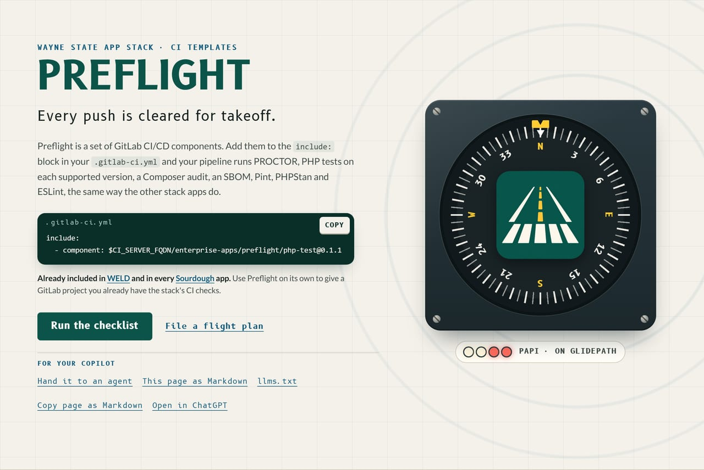
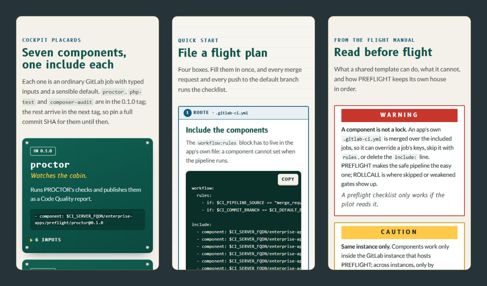
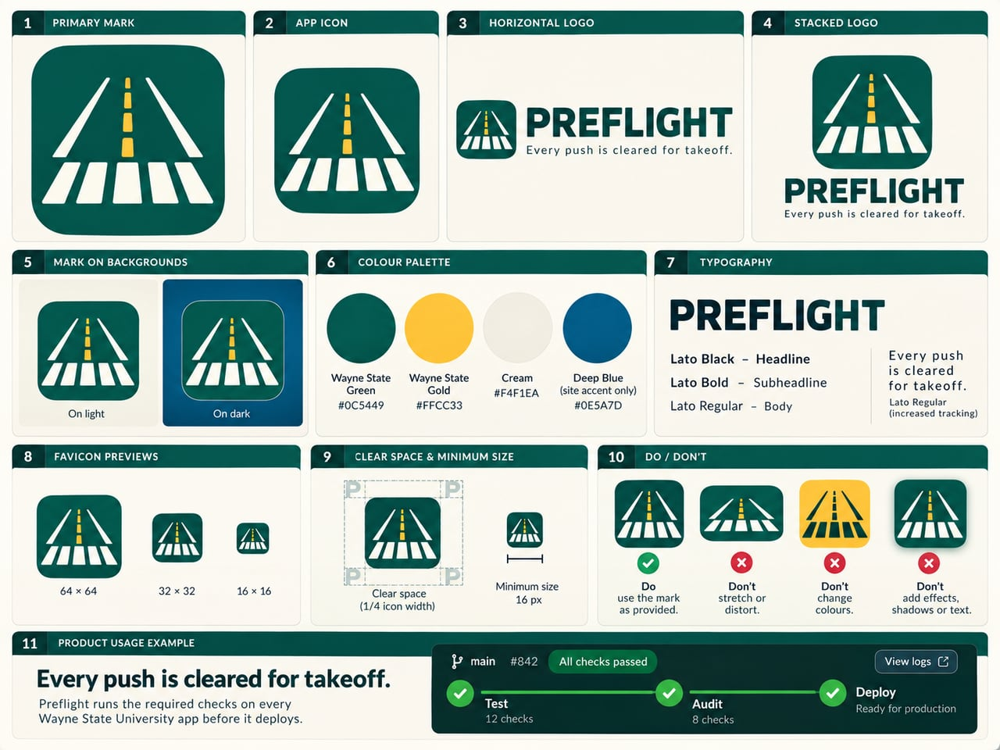

<div align="center">
  <a href="site/index.html"></a>
</div>

# PREFLIGHT

<div align="center">
  
  
  
</div>

**Every push is cleared for takeoff.**

PREFLIGHT is a set of GitLab CI/CD components that give every WSU app the
same checks: PROCTOR, PHP tests on each supported version, Composer audit,
an SBOM, Pint, PHPStan and ESLint.

Front page: [`site/index.html`](site/index.html), a static page; see [`site/README.md`](site/README.md).
On Citadel it is served by the raw-PHP deploy layer in [`deploy/`](deploy/): a SQUIRE kit whose front controller serves `site/` behind HELMET's security headers. For local development, keep serving `site/` directly.

Development happens on Wayne State's GitLab; this repository is a release mirror. Changes land there first.

<details>
<summary><b>Walk round the aircraft</b>: the placards, the flight plan and the flight manual from the front page</summary>
<br>
<div align="center"></div>
</details>

Components are GA on the Free tier since GitLab 17.0. They work only within
the same GitLab instance that hosts this project.

## Components

<div align="center">
  
</div>

<div align="center"><sub>The checklist, item by item, with each item's job and timeout read from <code>templates/</code>.</sub></div>

### proctor

Runs `vendor/bin/proctor check --format=codequality` and publishes the
result as a GitLab Code Quality report.

```yaml
include:
  - component: $CI_SERVER_FQDN/enterprise-apps/preflight/proctor@0.1.0
    inputs:
      proctor_command: vendor/bin/proctor check --format=codequality
```

| Input | Type | Default | What it does |
|-------|------|---------|--------------|
| `stage` | string | `test` | Pipeline stage for the job. |
| `image` | string | `php:8.4-cli-trixie@sha256:9cf851bc2c1b37c3e59dfd677a3c3e56d485af5a47c93f629424bb039eafcb69` | Docker image for the job. |
| `composer_version` | string | `2.10.3` | Composer version to install. |
| `allow_failure` | boolean | `false` | Whether the job can fail without failing the pipeline. |
| `proctor_command` | string | `vendor/bin/proctor check --format=codequality` | The proctor command to run. |
| `working_dir` | string | `.` | Directory to run the command in, relative to the project root. |

### php-test

Runs the test command on each supported PHP version through `parallel:matrix`.

```yaml
include:
  - component: $CI_SERVER_FQDN/enterprise-apps/preflight/php-test@0.1.0
    inputs:
      test_command: vendor/bin/phpunit
```

| Input | Type | Default | What it does |
|-------|------|---------|--------------|
| `stage` | string | `test` | Pipeline stage for the jobs. |
| `image` | string | `php:${PHP_VERSION}-cli-trixie` | Docker image for the jobs. The default carries the literal `${PHP_VERSION}`, which GitLab expands in the image at job time. |
| `php_versions` | array | `["8.3", "8.4", "8.5"]` | PHP versions to test against. |
| `composer_version` | string | `2.10.3` | Composer version to install. |
| `test_command` | string | `vendor/bin/phpunit` | The test command to run. |
| `working_dir` | string | `.` | Directory to run the command in, relative to the project root. |

#### Caching

The jobs always cache Composer downloads in `.composer-cache/` so repeat runs
do not re-download every package. The cache key depends on `composer.lock`
and is prefixed with the PHP version, so a dependency change invalidates the
cache and each PHP version gets its own cache.

### composer-audit

Runs `composer audit --locked` and fails on advisories.

```yaml
include:
  - component: $CI_SERVER_FQDN/enterprise-apps/preflight/composer-audit@0.1.0
    inputs:
      working_dir: .
```

| Input | Type | Default | What it does |
|-------|------|---------|--------------|
| `stage` | string | `test` | Pipeline stage for the job. |
| `image` | string | `composer:2@sha256:b6dcd72ca98fa19d0e5b8476de179859704891fad06dd9e0b96833d4c430a5fc` | Docker image for the job. |
| `working_dir` | string | `.` | Directory to run composer audit in, relative to the project root. |

### sbom

Generates a CycloneDX SBOM with `cyclonedx/cyclonedx-php-composer`, validates it, and publishes it as an artifact. The plugin is installed globally, so the app's `composer.json` is never touched.

```yaml
include:
  - component: $CI_SERVER_FQDN/enterprise-apps/preflight/sbom@<full-commit-sha>
    inputs:
      output: sbom.cdx.json
```

This component is not in `0.1.0`; it arrives in the next tag. Until then, pin a full commit SHA instead.

| Input | Type | Default | What it does |
|-------|------|---------|--------------|
| `stage` | string | `test` | Pipeline stage for the job. |
| `image` | string | `composer:2.10.3@sha256:b6dcd72ca98fa19d0e5b8476de179859704891fad06dd9e0b96833d4c430a5fc` | Docker image for the job. |
| `omit_dev` | boolean | `true` | Whether to omit dev dependencies from the SBOM. |
| `output` | string | `sbom.cdx.json` | Path of the SBOM file to publish, relative to the project root. |

### pint

Version 1 · Category: Testing/Validation · Tags: php,style,pint

Runs the app's own [Laravel Pint](https://laravel.com/docs/12.x/pint) in test mode and fails the pipeline on style errors. The app must require `laravel/pint` as a dev dependency and ship a `pint.json` (or point `config` at its own file).

```yaml
include:
  - component: $CI_SERVER_FQDN/enterprise-apps/preflight/pint@<full-commit-sha>
    inputs:
      config: pint.json
```

This component is not in `0.1.0`; it arrives in the next tag. Until then, pin a full commit SHA instead.

| Input | Type | Default | What it does |
|-------|------|---------|--------------|
| `stage` | string | `test` | Pipeline stage for the job. |
| `image` | string | `composer:2.10.3@sha256:b6dcd72ca98fa19d0e5b8476de179859704891fad06dd9e0b96833d4c430a5fc` | Docker image for the job. |
| `config` | string | `pint.json` | Path to the app's Pint config file. |
| `working_dir` | string | `.` | Directory to run Pint in, relative to the project root. |

### phpstan

Version 1 · Category: Testing/Validation · Tags: php,static-analysis,phpstan

Runs the app's own [PHPStan](https://phpstan.org/) and fails the pipeline on static analysis errors, writing a GitLab Code Quality report. The app must require `phpstan/phpstan` as a dev dependency and ship a `phpstan.neon` (or point `config` at its own file).

```yaml
include:
  - component: $CI_SERVER_FQDN/enterprise-apps/preflight/phpstan@<full-commit-sha>
    inputs:
      config: phpstan.neon
      memory_limit: 1G
```

This component is not in `0.1.0`; it arrives in the next tag. Until then, pin a full commit SHA instead.

| Input | Type | Default | What it does |
|-------|------|---------|--------------|
| `stage` | string | `test` | Pipeline stage for the job. |
| `image` | string | `composer:2.10.3@sha256:b6dcd72ca98fa19d0e5b8476de179859704891fad06dd9e0b96833d4c430a5fc` | Docker image for the job. |
| `config` | string | `phpstan.neon` | Path to the app's PHPStan config file. |
| `memory_limit` | string | `1G` | Memory limit passed to PHPStan. |
| `working_dir` | string | `.` | Directory to run PHPStan in, relative to the project root. |

### eslint

Version 1 · Category: Testing/Validation · Tags: javascript,style,eslint,prettier

Runs the app's own [ESLint](https://eslint.org/) (and [Prettier](https://prettier.io/)) and fails the pipeline on lint or format errors. The app must require `@waynestate/pinstripe`, `eslint` and `prettier` as dev dependencies and ship an `eslint.config.js` (or point `eslint_args` at its own files).

```yaml
include:
  - component: $CI_SERVER_FQDN/enterprise-apps/preflight/eslint@<full-commit-sha>
    inputs:
      eslint_args: .
```

This component is not in `0.1.0`; it arrives in the next tag. Until then, pin a full commit SHA instead.

| Input | Type | Default | What it does |
|-------|------|---------|--------------|
| `stage` | string | `test` | Pipeline stage for the job. |
| `image` | string | `node:22.13-alpine@sha256:e2b39f7b64281324929257d0f8004fb6cb4bf0fdfb9aa8cedb235a766aec31da` | Docker image for the job. |
| `working_dir` | string | `.` | Directory to run the commands in, relative to the project root. |
| `eslint_args` | string | `.` | Arguments passed to eslint. |
| `prettier` | boolean | `true` | Whether to also run `prettier --check`. |

### package-publish

Version 1 · Category: Release/Publishing · Tags: composer,publish,release

Publishes a semantic version tag to the GitLab group's built-in Composer
registry. The job runs only on tags, reads the registry first, and refuses a
moved version: a version already published from this commit passes quietly,
and a version published from a different commit fails the pipeline, because
GitLab would otherwise overwrite it without a word. The default image ships
curl and PHP, which the job uses for the registry round trip.

```yaml
include:
  - component: $CI_SERVER_FQDN/enterprise-apps/preflight/package-publish@<full-commit-sha>
    inputs:
      group_id: "<your group id>"
```

This component is not in `0.1.0`; it arrives in the next tag. Until then, pin a full commit SHA instead.

| Input | Type | Default | What it does |
|-------|------|---------|--------------|
| `stage` | string | `deploy` | Pipeline stage for the job. |
| `image` | string | `composer:2.10.3@sha256:b6dcd72ca98fa19d0e5b8476de179859704891fad06dd9e0b96833d4c430a5fc` | Docker image for the job. The default ships curl and PHP, which the job uses for the registry round trip. |
| `group_id` | string | none | Numeric id of the GitLab group whose built-in Composer registry hosts the package. Required. |
| `read_token_variable` | string | `PACKAGE_READ_TOKEN` | Name of the masked CI variable holding a token with the `read_package_registry` scope, used to read the registry before publishing. |

Protect your release tags.

## Same instance only

Components work only inside the GitLab instance that hosts this project.
Components cannot be used across instances except by mirroring.

## GitHub mirrors

Components work only inside one GitLab instance, so a package that is also
mirrored to `github.com/waynestate` cannot include them there. For those
mirrors, PREFLIGHT ships a reusable GitHub Actions workflow that runs the same
checks: the package's `composer ci` script on each supported PHP version, plus
a Composer audit.

Each package keeps its checks in a `ci` script in its `composer.json`; the
workflow just calls `composer ci`, so the mirror runs whatever the package
already runs on GitLab.

The workflow lives at `.github/workflows/php-package.yml` in this repo. A
mirrored package calls it from its own `.github/workflows/ci.yml`:

```yaml
name: CI

on:
  push:
    branches: ['**']
    tags: ['v*', '*.*.*']

jobs:
  ci:
    uses: waynestate/preflight/.github/workflows/php-package.yml@<full-commit-sha>
```

This workflow is not in `0.1.0`; it arrives in the next tag. Until then, pin a
full commit SHA instead.

| Input | Type | Default | What it does |
|-------|------|---------|--------------|
| `php-versions` | string (JSON array) | `'["8.3","8.4","8.5"]'` | PHP versions to test, lowest first. The audit job runs on the first entry. |
| `ci-command` | string | `composer ci` | The command to run in each PHP version job. |
| `working-directory` | string | `.` | Directory to run the command in, relative to the repository root. |

The workflow is committed to this repo (and so to GitLab) but only runs on the
GitHub mirror; GitLab ignores `.github/workflows`. A release tag is not done
until it is green on both sides. Two cockpits, one checklist.

## When the components run

The components are ordinary jobs, so they run whenever the app's pipeline
runs. To run them on every merge request and on pushes to the default
branch, put a `workflow:rules` block in the app's own `.gitlab-ci.yml`:

```yaml
workflow:
  rules:
    - if: $CI_PIPELINE_SOURCE == "merge_request_event"
    - if: $CI_COMMIT_BRANCH == $CI_DEFAULT_BRANCH

include:
  - component: $CI_SERVER_FQDN/enterprise-apps/preflight/proctor@0.1.0
  - component: $CI_SERVER_FQDN/enterprise-apps/preflight/php-test@0.1.0
  - component: $CI_SERVER_FQDN/enterprise-apps/preflight/composer-audit@0.1.0
  - component: $CI_SERVER_FQDN/enterprise-apps/preflight/sbom@<full-commit-sha>
  - component: $CI_SERVER_FQDN/enterprise-apps/preflight/pint@<full-commit-sha>
  - component: $CI_SERVER_FQDN/enterprise-apps/preflight/phpstan@<full-commit-sha>
  - component: $CI_SERVER_FQDN/enterprise-apps/preflight/eslint@<full-commit-sha>
```

The `workflow:rules` block must live in the app's own file. A component
cannot set the pipeline's `workflow:rules` for the project that includes it,
so the `merge_request_event` rule goes in the app's `.gitlab-ci.yml`.

## What the components cannot force

An included component is a set of ordinary jobs. The app's own `.gitlab-ci.yml` is merged over them, so an app can
override a job's keys, skip it with `rules`, or delete the `include:` line. PREFLIGHT makes the safe pipeline the easy
one; it does not lock it. ROLLCALL is where skipped or weakened gates will show up. A preflight checklist only works
if the pilot reads it.

Three project settings make the gates harder to skip. All three work on GitLab Community Edition:

- **Protect the default branch** and require a merge request to change it. Every change to `.gitlab-ci.yml` then
  gets a reviewer. (Code owner approval needs Premium, so on Community Edition the reviewer is whoever merges.)
- **Set "Minimum role to use pipeline variables" to `no_one_allowed`** unless the project needs pipeline variables.
  The components take inputs, which are fixed and type checked for the whole run. Self-managed GitLab defaults this
  setting to `maintainer`.
- **Keep secrets away from fork merge requests.** A fork's merge request pipeline runs the fork's configuration.
  Review a fork's `.gitlab-ci.yml` before running its pipeline, and never give it protected variables.


## Strongly recommended: a git.wayne.edu instance runner.

Until git.wayne.edu has a runner, CI runs on the GitLab instance that has one, and PREFLIGHT and each
app must live on or be mirrored to it. A git.wayne.edu instance runner is strongly recommended.

## Shared conventions

- Composer vendor: `waynestate/`
- Licence: MIT
- PHP floor: `^8.3`
- JavaScript components install with `npm ci --ignore-scripts`. The job carries no token beyond `CI_JOB_TOKEN` (BEST_PRACTICES.md 4.12).

## Updating image pins

Every image the components run is pinned by digest (`name:tag@sha256:...`),
so a repointed tag cannot quietly change what a pipeline executes. The tag
stays in front of the digest so a diff still reads like a version bump.

The php-test matrix is the one exception. Its PHP images are tag-pinned on
purpose, so those jobs run on the newest PHP patch release; every other
component image is digest-pinned.

To look up the digest for an image:

```sh
docker buildx imagetools inspect <image>:<tag>
```

Use the top-level `Digest:` line (the multi-arch index digest), not a
per-platform one. Without `buildx`, `docker manifest inspect -v <image>:<tag>`
shows the same index digest.

Pins change only through a reviewed merge request.

## Template lint

`composer ci` runs `bin/lint-templates` before the fixture tests. The lint scans
`templates/**/*.yml` and `.github/workflows/*.yml` for unsafe CI patterns:

- `privileged`: `privileged: true`
- `dind-service`: Docker-in-Docker services
- `docker-sock`: references to `docker.sock`
- `kaniko-image`: Kaniko images
- `unpinned-action`: GitHub `uses:` entries that are not pinned to a 40-character SHA
- `image-no-tag` and `image-latest`: image references with no tag or with `latest`
- `image-no-digest`: a warning for a tagged image that is not pinned by digest

The container-build rules (`privileged`, `dind-service`, `docker-sock` and `kaniko-image`) are explained in
BEST_PRACTICES.md 4.17.

Known warnings can be allowlisted in `lint-allow.yml`. Each entry needs `file`,
`rule` and `reason`; the reason is required so an allowlist entry is a reviewed
decision, not a silence. The preflight checklist checks the checklist.

## Local checks

Run the template lint and the fixture tests with Docker:

```sh
docker run --rm -v "$(pwd):/app" -w /app composer:2 composer install
docker run --rm -v "$(pwd):/app" -w /app composer:2 composer ci
```

Run the PHP fixture app separately:

```sh
docker run --rm -v "$(pwd)/tests/fixture-app:/app" -w /app composer:2 composer install
docker run --rm -v "$(pwd)/tests/fixture-app:/app" -w /app php:8.4-cli vendor/bin/phpunit
```


<details>
<summary><b>The brand board</b>: the runway mark, lockups, palette and type</summary>
<br>
<div align="center"></div>
</details>

## The cast

<div align="center">
  <a href="https://github.com/waynestate/wayne-ui" title="WayneUI"></a>
  <a href="https://github.com/waynestate/creed" title="CREED"></a>
  <a href="https://github.com/waynestate/proctor" title="PROCTOR"></a>
  <a href="https://github.com/waynestate/sesame" title="SESAME"></a>
  <a href="https://github.com/waynestate/helmet" title="HELMET"></a>
  <a href="https://github.com/waynestate/sourdough" title="Sourdough"></a>
  <a href="https://github.com/waynestate/squire" title="SQUIRE"></a>
  <a href="https://github.com/waynestate/preflight" title="PREFLIGHT"></a>
  <a href="https://github.com/waynestate/pinstripe" title="Pinstripe"></a>
  <a href="https://github.com/waynestate/booster" title="BOOSTER"></a>
  <a href="https://github.com/waynestate/rollcall" title="ROLLCALL"></a>
  <a href="https://github.com/waynestate/drawbridge" title="DRAWBRIDGE"></a>
  <a href="https://github.com/waynestate/advisor" title="ADVISOR"></a>
  <a href="https://github.com/waynestate/weld" title="WELD"></a>
</div>

<div align="center"><sub>Fourteen on the manifest, every one checked in. The README art is cut from the front page by
<a href="scripts/readme-art/README.md"><code>scripts/readme-art</code></a>; no runways were painted in its making.</sub></div>
