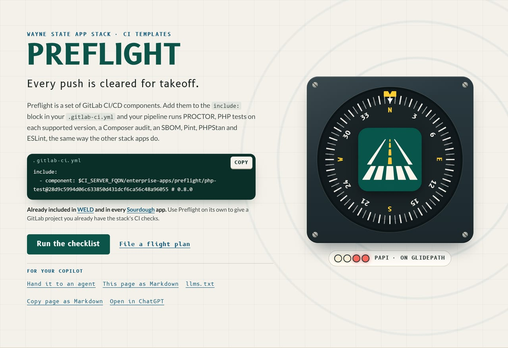
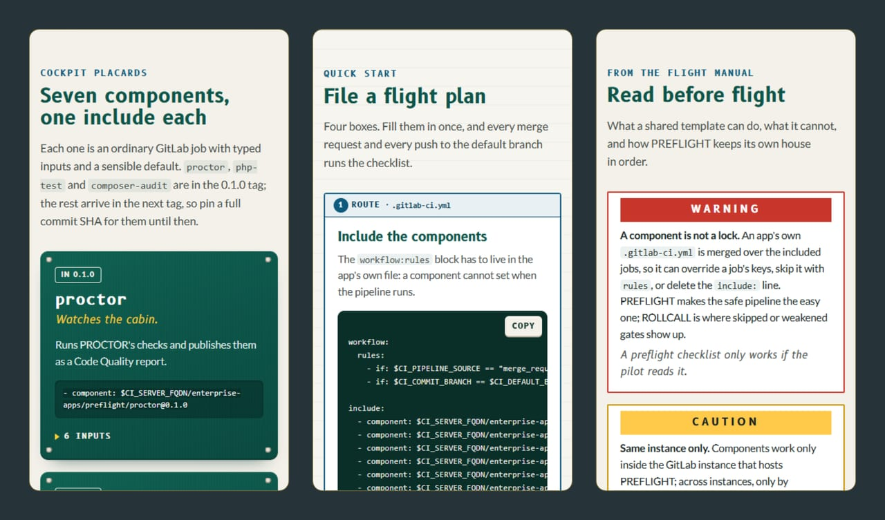

  

# Preflight

  
  
  

**Every push is cleared for takeoff.**

Preflight is a set of GitLab CI/CD components that give every WSU app the
same checks: PROCTOR, PHP tests on each supported version, Composer audit,
an SBOM, Pint, PHPStan and ESLint.

**Not to be confused with:** Preflight is the CI pipeline; it runs Pinstripe's style checks and PROCTOR but sets neither.

Front page: [`site/index.html`](https://github.com/waynestate/preflight/blob/main/site/index.html), a static page; see [`site/README.md`](https://github.com/waynestate/preflight/blob/main/site/README.md).
On Citadel it is served by the raw-PHP deploy layer in [`deploy/`](https://github.com/waynestate/preflight/tree/main/deploy): a Squire kit whose front controller serves `site/` behind HELMET's security headers. For local development, keep serving `site/` directly.

## Where the code lives

The canonical repository is on nougat: [enterprise-apps/preflight](https://nougat.snu.gs/enterprise-apps/preflight). git.wayne.edu and GitHub ([waynestate/preflight](https://github.com/waynestate/preflight)) are read-only mirrors of it.
Open issues and merge requests on nougat, not on the mirrors.
This moves to git.wayne.edu once it has CI runners. Cleared for takeoff from nougat; the mirrors are just other gates.

<b>Walk round the aircraft</b>: the placards, the flight plan and the flight manual from the front page

 

Components are GA on the Free tier since GitLab 17.0. They work only within
the same GitLab instance that hosts this project.
